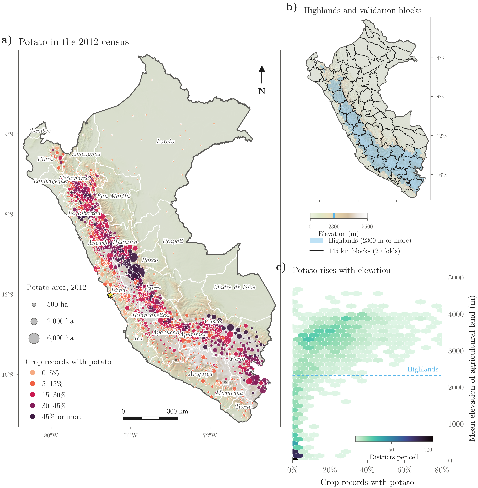
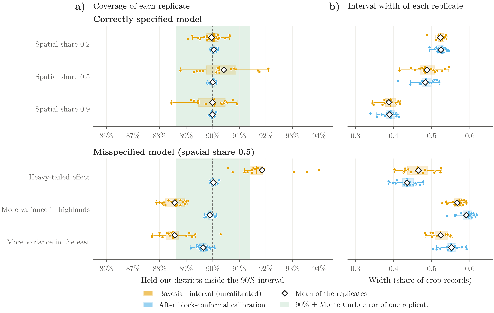
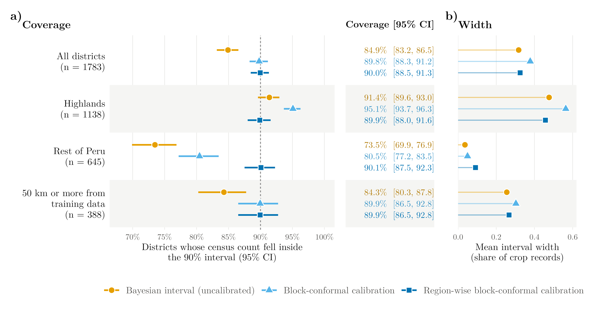
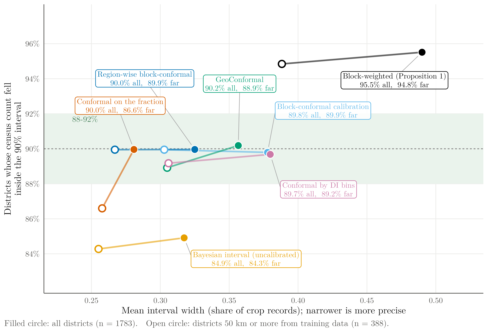
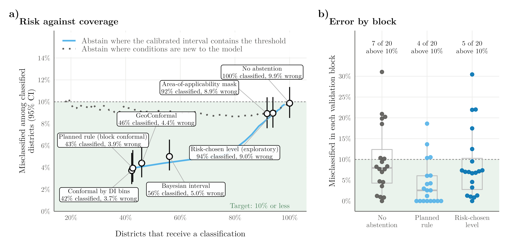
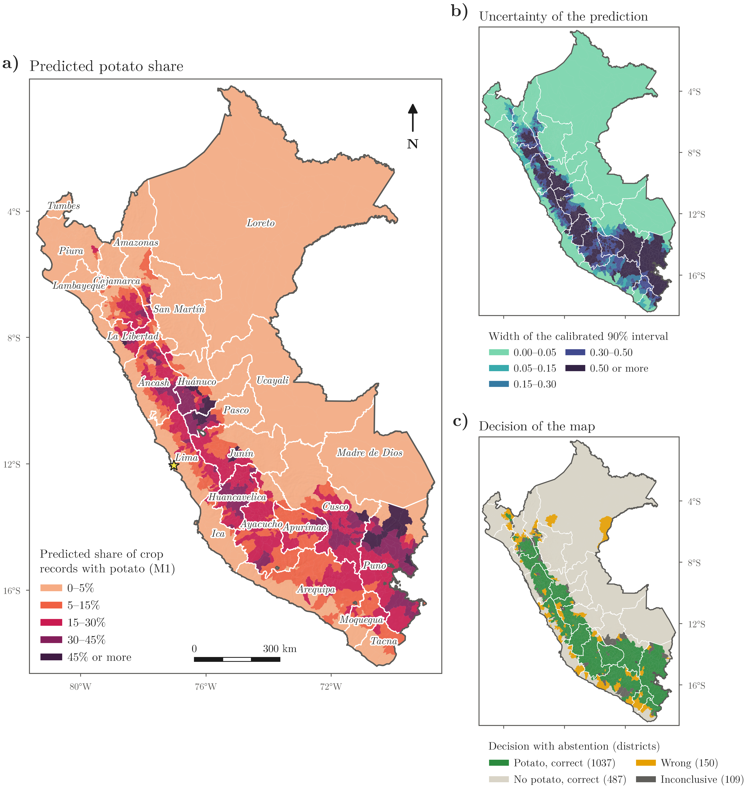

# Mapping potato suitability and its uncertainty across the districts of Peru with a calibrated Bayesian model

**Mapping potato suitability and its uncertainty across the districts of Peru with a calibrated Bayesian model** (submitted to *Computers and Electronics in Agriculture*)

[-E9711C?style=flat-square&logo=elsevier&logoColor=white)](https://www.sciencedirect.com/journal/computers-and-electronics-in-agriculture)
[](#status)
[](https://doi.org/10.17632/mcp876jbyt.1)
[](#data)
[](https://www.r-project.org/)
[](https://www.r-inla.org/)
[](https://www.python.org/)
[](LICENSE)
[](LICENSE-DATA)

Richar Andre Vilca-Solorzano · Vladimiro Ibañez-Quispe · Fred Torres-Cruz
*Department of Statistical and Informatics Engineering, Universidad Nacional del Altiplano (UNAP), Puno, Peru · Doctoral Program in Sustainable Agriculture, Universidad Nacional Agraria La Molina, Lima, Peru (F. Torres-Cruz)*

---

## Overview

Bayesian areal models such as **BYM2** give a predictive interval for every area, and these intervals are used to decide where a map can be trusted. This project measures whether they keep their nominal coverage when the model predicts into regions without training data, calibrates them when they do not, and uses the calibrated sets to let a map abstain where it cannot classify.

1. **Simulation with known truth** on the real adjacency graph of the 1783 districts of Peru and their census denominators: coverage of 90% sets as a function of distance to training areas, block size (25, 75, 145 km) and spatial share of the random effect (φ = 0.2, 0.5, 0.9), plus three misspecified models (heavy-tailed random effect, and variance larger in the highlands or in the eastern half).
2. **Block-conformal calibration for binomial counts**, based on randomized probability integral transforms (PIT) of the out-of-block posterior predictive distribution, with a coverage guarantee under exchangeable blocks and a region-wise (Mondrian) version.
3. **Risk-controlled selective prediction**: the map leaves a district as inconclusive when the calibrated set or the area of applicability does not support a classification, with the error among classified districts controlled at 10%.
4. **Application to a complete agricultural census** (4.8 million crop records): BYM2 (M1), a non-spatial binomial model (M2), random forest (M3), MaxEnt (M4) and the expert multicriteria zoning used in Peru (M5, FAO ECOCROP + TOPSIS), compared in 20 spatial blocks of 145 km.

<p align="center">
  
  <br><sub><b>Figure 1.</b> Study area. a) Districts with potato in the 2012 census, sized by potato area and coloured by the share of crop records with potato. b) Highland districts (2300 m or more) and the 145 km validation blocks. c) Share of records with potato against mean elevation of agricultural land.</sub>
</p>

## Main results

| Question | Result |
| --- | --- |
| Do BYM2 intervals lose coverage far from the data? | Not when the model is correct (0.896–0.904 at every distance). Misspecification moves coverage to 0.919 (heavy tails) or 0.886 (non-stationary variance). In the census, nominal sets covered **0.849** of districts. |
| Does block-conformal calibration restore it? | Yes: 0.896–0.900 in the three misspecified simulations, **0.898** in the census, and 0.899 for districts 50 km or more from any training district. |
| Is coverage uniform across regions? | No. One threshold gave 0.951 in the highlands and 0.805 elsewhere. A region-wise threshold gave **0.899 and 0.901**, with sets 14% narrower (exploratory); in simulation it helps only when the regions match the variance structure. |
| Can the map abstain with controlled error? | The planned rule classified 42.6% of districts with 3.9% errors. Choosing the set level by risk control classified **93.9%** with 9.0% errors (exploratory). |
| Fitted models vs. expert zoning | AUC 0.954 (M1) and 0.953 (M3) against 0.664 (M5): **+0.29** (block bootstrap 95% CI 0.16–0.42), stable in all seven sensitivity analyses, including PISCO climate. |

<p align="center">
  
  <br><sub><b>Figure 2.</b> Simulation with 145 km blocks. a) Coverage of the 90% interval and b) mean interval width in each replicate, before and after block-conformal calibration.</sub>
</p>

<p align="center">
  
  <br><sub><b>Figure 3.</b> Coverage of the 90% intervals of M1 in the census by region and distance. a) Coverage with Clopper–Pearson 95% intervals. b) Mean interval width.</sub>
</p>

<p align="center">
  
  <br><sub><b>Figure 4.</b> Coverage against mean width of the 90% intervals of M1 in the census for seven rules, for all districts and for those 50 km or more from training data.</sub>
</p>

<p align="center">
  
  <br><sub><b>Figure 5.</b> Selective prediction of potato presence. a) Misclassification rate against the share of districts classified. b) Misclassification rate in each of the 20 folds.</sub>
</p>

<p align="center">
  
  <br><sub><b>Figure 6.</b> Cross-validated potato predictions of M1. a) Predicted share of crop records with potato. b) Width of the calibrated 90% interval. c) Decision of the map, with the number of districts in brackets.</sub>
</p>

## Repository layout

```
.
├── data/                          District-level data (CC BY 4.0)
│   ├── tabla_distrital_2012.csv   1783 districts × 63 variables (dictionary in data/README.md)
│   ├── clima_pisco_distrito_2012.csv  M1 climate covariates from PISCO (sensitivity analysis)
│   ├── limites/distritos_2012.gpkg    District polygons harmonised to the 2012 census
│   ├── ubigeo_2023_a_2012.csv     2023 district codes mapped to 2012 census districts
│   ├── etiqueta_papa_distrito_2012.csv  Census potato counts by district
│   └── SOURCES.md                 References, DOIs and licences of every source
├── data-raw/                      Download and build the district table from public sources
│   ├── FUENTES.md                 Sources with URL, period and licence
│   ├── descargar.sh               Downloads (CENAGRO, TerraClimate, PISCO, SoilGrids, DEM, ...)
│   ├── construir_tabla.sh         Runs the seven build steps in order
│   ├── clima_pisco.py             PISCO climate by district (sensitivity analysis)
│   ├── relieve_sombreado.R        Hillshade of Peru from Copernicus GLO-90 for the maps
│   ├── fuentes_lm/                Latin Modern fonts used in the figures (GUST Font License)
│   └── requirements.txt           Python packages
├── 03-codigo/                     Statistical analysis (R), run in numerical order
│   ├── 00_comun.R                 Paths, seed, variables, in-fold preprocessing
│   ├── 01_grafo_bloques.R         Adjacency graph and 20 spatial blocks of 145 km
│   ├── 02_simulacion.R            Simulation (one replicate per call) and its launchers *_lanzar.sh
│   ├── 03_resumen_simulacion.R    Coverage tables: overall, by distance and by region
│   ├── 04_aplicacion_censo.R      Census: one fold of M1–M5 per call, and its launcher
│   ├── 05_figuras.py              Figures 1, 2 and 6 (seaborn, matplotlib, geopandas)
│   ├── 05_figuras.R               Figures 3, 4 and 5 (ggplot2, patchwork) and the location globe
│   ├── 06_analisis_censo.R        Hypotheses, calibration rules, abstention
│   ├── 07_sensibilidad.R          Sensitivity analyses and neighbour-excluded validation
│   ├── 08_analisis_sensibilidad.R Sensitivity summary
│   ├── 09_confusion_espacial.R    M1 vs. M2 coefficients and restricted spatial regression
│   └── versiones_R.txt            R package versions
├── 04-resultados/                 Result tables (large .rds outputs are regenerated)
├── figuras/                       Figures (PNG)
├── docs/                          Analysis plan fixed before model fitting, with its 13 deviations (Spanish)
├── CITATION.cff
├── LICENSE                        MIT (code)
└── LICENSE-DATA                   CC BY 4.0 (data)
```

## Reproduce

Run every command from the repository root. All scripts use the seed `20261116`. Each launcher runs one task per R process with single-threaded BLAS; set `PARALELO` to the number of processes. Finished tasks are skipped, so a launcher can be stopped and restarted.

| Step | Command | Time (8 processes) |
| --- | --- | --- |
| Graph and blocks | `Rscript 03-codigo/01_grafo_bloques.R` | 1 min |
| Simulation, correct model | `PARALELO=8 sh 03-codigo/02_simulacion_lanzar.sh` | ~6 h |
| Simulation, misspecified models | `PARALELO=8 sh 03-codigo/02_simulacion_mal_lanzar.sh` | ~3 h |
| Simulation summaries | `Rscript 03-codigo/03_resumen_simulacion.R` and `... mal` | 2 min |
| Census, 20 folds | `PARALELO=4 sh 03-codigo/04_aplicacion_lanzar.sh` | under 1 h |
| Census analysis | `Rscript 03-codigo/06_analisis_censo.R` | 30 s |
| Sensitivity analyses | `PARALELO=6 sh 03-codigo/07_sensibilidad_lanzar.sh` then `Rscript 03-codigo/08_analisis_sensibilidad.R` | several hours |
| Spatial confounding | `Rscript 03-codigo/09_confusion_espacial.R` | 1 min |
| Figures | `Rscript data-raw/relieve_sombreado.R`, `Rscript 03-codigo/05_figuras.R`, then `.venv/bin/python 03-codigo/05_figuras.py` (`python3 -m venv .venv && .venv/bin/pip install -r data-raw/requirements.txt`) | 3 min |

**From the raw sources** (about 6 GB of downloads):

```bash
pip install -r data-raw/requirements.txt
bash data-raw/descargar.sh todo
sh data-raw/construir_tabla.sh
python3 data-raw/clima_pisco.py
```

The build checks itself: potato area must add up to the official 367,692 ha, every district must have climate, and minimum temperature must fall with elevation (r < −0.8).

## Data

The district table combines the IV National Agricultural Census 2012 (INEI), TerraClimate 1981–2025, PISCO (SENAMHI), SoilGrids 2.0, Copernicus GLO-90, the MIDAGRI 2024 agricultural land map, MODIS MOD13Q1/MYD13Q1 and the Malaria Atlas Project travel-time surface, all aggregated over agricultural land. Only district-level aggregates are distributed; census microdata remain with INEI under its terms of use. **Full references, DOIs and licences for every source are in [`data/SOURCES.md`](data/SOURCES.md); please cite them together with this repository.**

## Status

| Component | State |
| --- | --- |
| District table, graph and blocks | Done |
| Simulation (55 + 56 replicates) | Done |
| Census application, hypotheses H1, H1b, H2 | Done (all supported) |
| Sensitivity analyses (7) and spatial confounding check | Done |
| Figures 1–6 | Done |
| Manuscript | Submitted to *Computers and Electronics in Agriculture* on 25 November 2026; with the editor |
| Data and code on Mendeley Data | [doi:10.17632/mcp876jbyt.1](https://doi.org/10.17632/mcp876jbyt.1) |

## Citation

If you use this code or the district table, please cite the dataset (and the original sources listed in [`data/SOURCES.md`](data/SOURCES.md)):

> Vilca-Solorzano, R.A., Ibañez-Quispe, V., Torres-Cruz, F., 2026. Data and code for: Agricultural suitability of potato across Peru from a calibrated Bayesian areal model [dataset]. Mendeley Data, V1. https://doi.org/10.17632/mcp876jbyt.1

The article is under review at *Computers and Electronics in Agriculture*; the reference will be added here once it is published. Machine-readable metadata are in [`CITATION.cff`](CITATION.cff).

## License

Code: [MIT](LICENSE). Data and figures: [CC BY 4.0](LICENSE-DATA).

## Contact

Richar Andre Vilca-Solorzano · [andrevilcasolorzano@gmail.com](mailto:andrevilcasolorzano@gmail.com) · ORCID [0009-0003-2385-5263](https://orcid.org/0009-0003-2385-5263)
